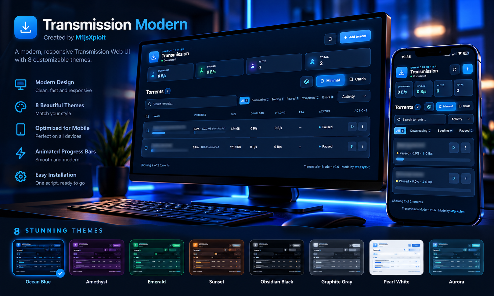
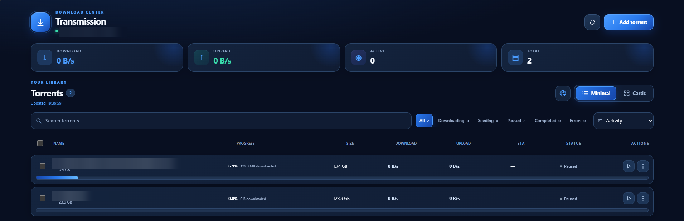
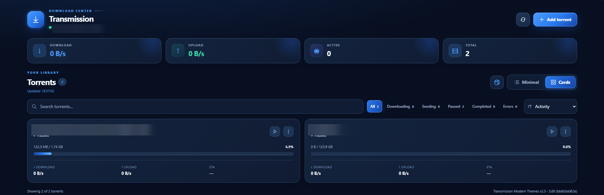
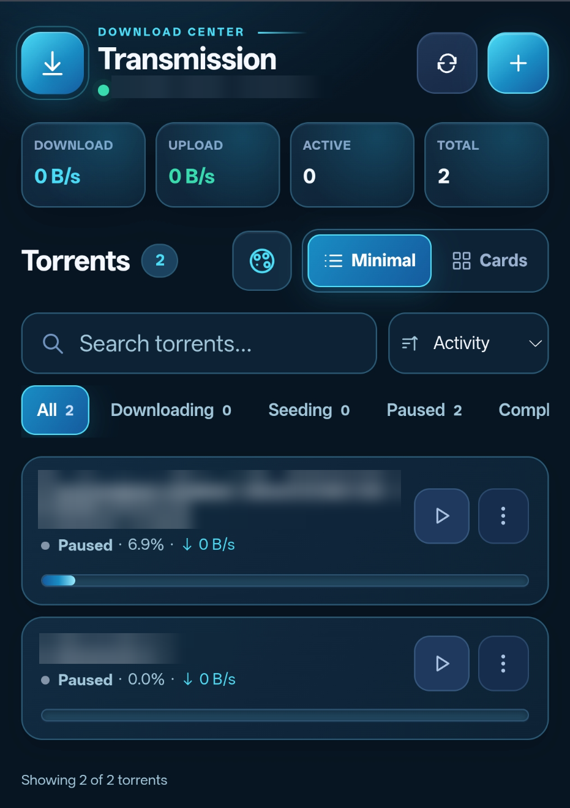
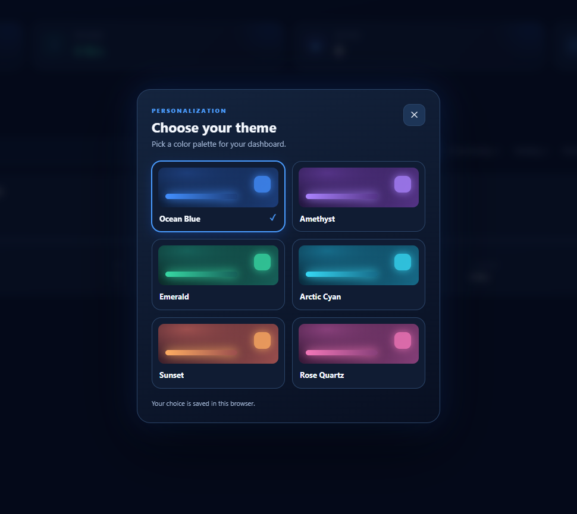

<p align="center">
  
</p>

<h1 align="center">Transmission Modern</h1>

<p align="center">
  A modern, responsive Transmission Web UI with 8 customizable themes.
  <br>
  Created by <strong>M1jsXploit</strong>
</p>

---

# Transmission Modern

**A modern, responsive and customizable web interface for Transmission.**

Developed by **M1jsXploit** · **v2.6.0** · Vanilla HTML, CSS and JavaScript · No build step

Transmission Modern replaces the default Transmission web interface with a clean, dark-first dashboard designed for both desktop and mobile browsers. It combines compact torrent management, animated progress indicators and eight selectable color themes, while continuing to use your existing Transmission daemon and RPC endpoint.

> **Unofficial community project.** Not affiliated with, maintained by, or endorsed by the Transmission project.

## Preview

### Desktop — Minimal view

A compact, table-like overview for quickly scanning torrents, transfer rates, progress and status. The progress indicator runs along the bottom **inside each torrent row**.



### Desktop — Cards view

An alternative layout with more space for each torrent's status, transfer speeds and progress.



### Mobile — Responsive dashboard

A touch-friendly interface with a compact overview, search, filters and torrent actions. The screenshot below uses the **Arctic Cyan** accent style from an earlier build.

<p align="center">
  
</p>

### Theme selector

Pick a theme from the palette button beside the **Minimal / Cards** switch. Your choice is saved locally in the current browser.



*Theme picker screenshot from v2.5 (six options shown). Version 2.6 includes the full eight-theme selection listed below.*

> All screenshots have been cropped to the application and identifying torrent names/server addresses have been blurred for privacy.

## Features

| Category | What you get |
| --- | --- |
| **Dashboard** | Live download/upload speeds, active and total torrent counts, connection status |
| **Two layouts** | Desktop-friendly **Minimal** and **Cards** views |
| **Mobile support** | Responsive portrait UI and automatic compact view for phone landscape |
| **Torrent management** | Add torrents using a magnet link, URL or `.torrent` file; pause, resume and remove |
| **Details** | Torrent information with **General**, **Files**, **Peers** and **Trackers** tabs |
| **Finding torrents** | Search, status filters and sorting by activity, name, progress, speed, size or date added |
| **Batch actions** | Select torrents to pause, resume or remove multiple items |
| **Progress indicators** | Smoothly animated progress bars with download percentage and downloaded amount |
| **Personalization** | Eight themes, with the selected theme stored in your browser |
| **Lightweight** | Static HTML/CSS/JS; no framework, build pipeline or additional backend |

The UI refreshes its data from Transmission approximately every five seconds, with a manual refresh button available in the header.

## Eight color themes

| Theme | Style |
| --- | --- |
| **Ocean Blue** | Deep navy and electric blue — the original look |
| **Amethyst** | Dark purple with violet highlights |
| **Emerald** | Rich green and teal accents |
| **Sunset** | Warm orange and coral highlights |
| **Obsidian Black** | Near-black with restrained neutral accents |
| **Graphite Gray** | Charcoal and soft gray |
| **Pearl White** | Light background with blue accents |
| **Aurora** | Dark base with blue-green accents |

Open the **palette icon** above the torrent list to change the theme. The preference is saved with browser local storage, so desktop and phone can use different themes.

## Requirements

- A running **Transmission daemon** with its Web UI/RPC endpoint enabled.
- A modern desktop or mobile browser that can access the Transmission Web UI.
- For the included installer: a Linux host with Bash, `install`, `cp`, `mktemp`, and permission to write to the Transmission web directory.

**Tested setup:** Transmission **3.00** on Debian. Other daemon versions and operating systems may work, but are not all verified.

## Installation

The installer replaces files in Transmission's **web interface directory**, not the daemon itself. It creates a timestamped backup of that directory before copying the new UI. Existing torrents, downloaded data and daemon settings are not intentionally changed.

### Option A — Clone the GitHub repository

```bash
git clone https://github.com/M1jsXploit/transmission-modern.git
cd transmission-modern
sudo bash install.sh
```

### Option B — Install a release ZIP

Download the ZIP from **Releases**, transfer it to your Linux host and run:

```bash
unzip -o transmission-modern-v2.6.zip -d /tmp
sudo bash /tmp/transmission-modern-v2.6/install.sh
```

If your downloaded ZIP has a different filename, adjust the first command accordingly.

### Non-default web directory

By default, the installer targets:

```text
/usr/share/transmission/web
```

If your distribution or installation uses a different location, specify it explicitly:

```bash
sudo bash install.sh /path/to/transmission/web
```

The target directory must already exist and contain Transmission's original `index.html`. The installer will stop if it cannot find it.

### Open the interface

Visit your **existing** Transmission Web UI URL, for example:

```text
http://YOUR-SERVER:9091/transmission/web/?v=26
```

The `?v=26` suffix is a simple way to avoid an old cached page; it does not change your Transmission configuration.

If you still see the previous UI, force-refresh with **Ctrl + Shift + R** (desktop) or open a private tab (mobile). A Transmission daemon restart is usually unnecessary when only static web files have changed.

## Using the interface

1. **Add a torrent:** click **Add torrent** (`+` on smaller screens). Paste a magnet link or torrent URL, or choose a `.torrent` file. You can optionally set a download directory or add it paused.
2. **Pause / resume:** use the action button on a torrent row or card.
3. **Inspect details:** open the torrent's actions and choose its details, including files, peers and trackers.
4. **Filter / search:** use the search box and the **All / Downloading / Seeding / Paused / Completed / Errors** filters.
5. **Switch layout:** use **Minimal** or **Cards**. Phone landscape automatically uses the compact layout to conserve vertical space.
6. **Choose a theme:** click the palette icon. The selection is remembered on that browser.

**Be careful with removal:** the remove dialog can optionally delete downloaded data. Read the confirmation before proceeding.

## Backup and rollback

Every successful installation creates a backup under:

```text
/var/backups/transmission-modern/backup-YYYYMMDD-HHMMSS-XXXX/web
```

The installer prints the exact backup directory and rollback command. To restore the latest backup for the default web path, run the `restore.sh` file from your extracted project directory:

```bash
sudo bash restore.sh
```

To restore a specific backup or custom web path:

```bash
sudo bash restore.sh /var/backups/transmission-modern/backup-YYYYMMDD-HHMMSS-XXXX /path/to/transmission/web
```

**Note:** rollback restores the backed-up files over the current directory; it does not remove unrelated files added later. Keep your backup if you plan to experiment with multiple versions.

## Troubleshooting

| Symptom | Suggested check |
| --- | --- |
| **Old interface still appears** | Hard-refresh the page or use a private browser tab. |
| **Cannot connect to Transmission** | Confirm the daemon is running, its Web UI/RPC is accessible, and authentication or RPC allowlists are configured correctly. |
| **Installer cannot find the web directory** | Find the actual Transmission web path and pass it as the first installer argument. |
| **Theme resets or does not persist** | Check whether the browser blocks local storage or clears site data. |
| **Phone layout looks wrong** | Refresh after changing orientation; test in an up-to-date browser. |
| **Need the original UI back** | Use `restore.sh` and the backup printed by the installer. |

## Security and privacy

- **Do not expose the Transmission Web UI/RPC directly to the public internet** without appropriate access controls, network restrictions and encryption.
- This theme does **not** add authentication or HTTPS. Those must be configured separately.
- Review shell scripts before running them with `sudo`.
- The UI talks to the existing Transmission RPC endpoint on the same origin; no separate application server is required.
- Screenshot assets in this repository are sanitized. Please also redact server addresses, torrent names and any other sensitive information when opening an issue.

## Project structure

```text
transmission-modern/
├── index.html
├── css/                 # Layout, themes, responsive styles, progress bars
├── js/                  # Transmission RPC, rendering, actions, theme picker
├── docs/screenshots/    # Sanitized desktop and mobile screenshots
├── install.sh           # Back up and install web assets
├── restore.sh           # Restore an earlier web UI backup
├── README.md
├── CHANGELOG.md
├── CONTRIBUTING.md
└── LICENSE
```

## Contributing and feedback

Issues and pull requests are welcome. For bug reports, include the Transmission version, operating system, browser, viewport/device, steps to reproduce, and a **privacy-safe screenshot** when useful. See [CONTRIBUTING.md](CONTRIBUTING.md).

## License and credits

Released under the [MIT License](LICENSE). Developed by **M1jsXploit**.

Transmission is a separate project. This repository provides an **unofficial alternative web UI**, not a modified Transmission daemon.
